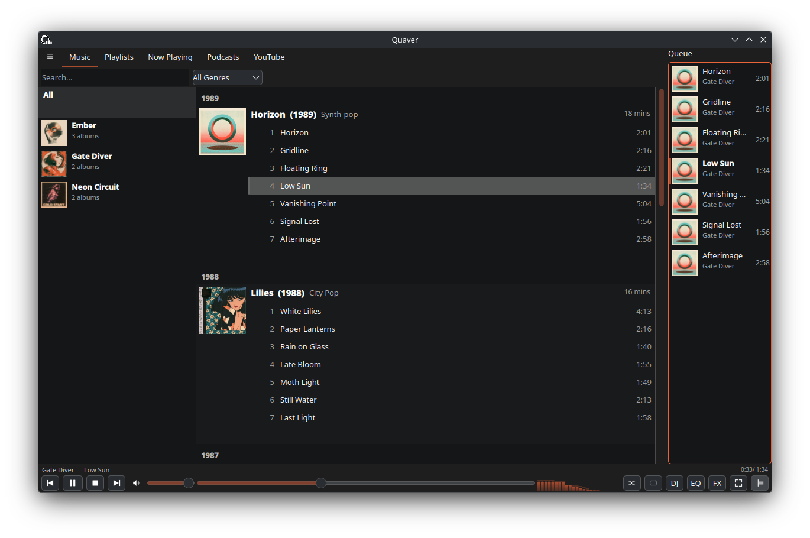
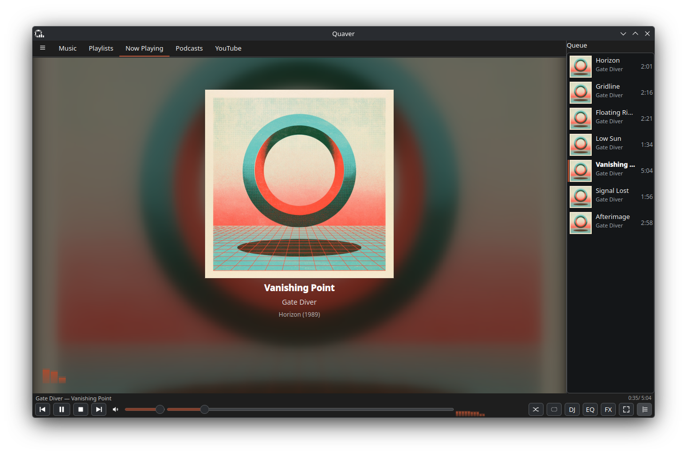
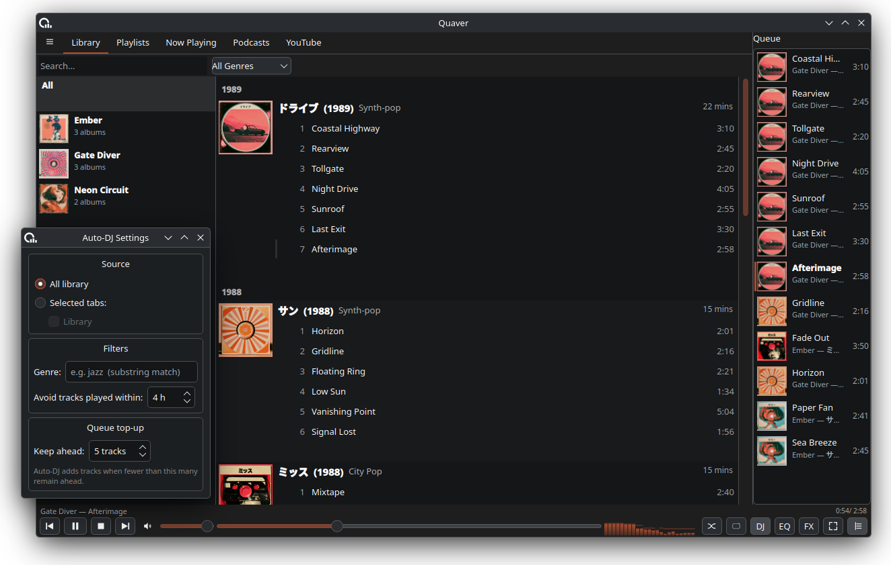
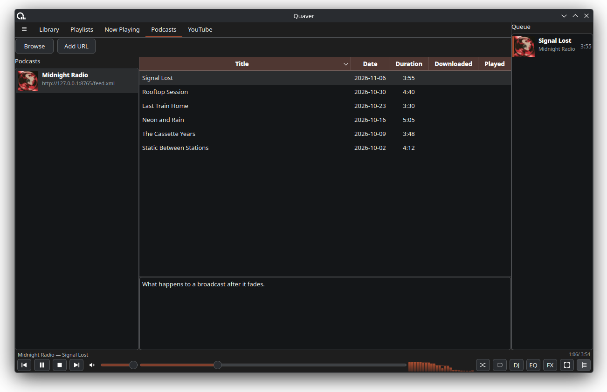
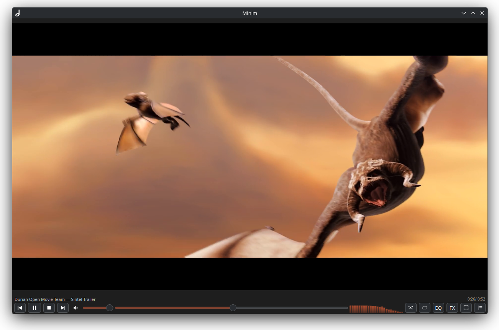
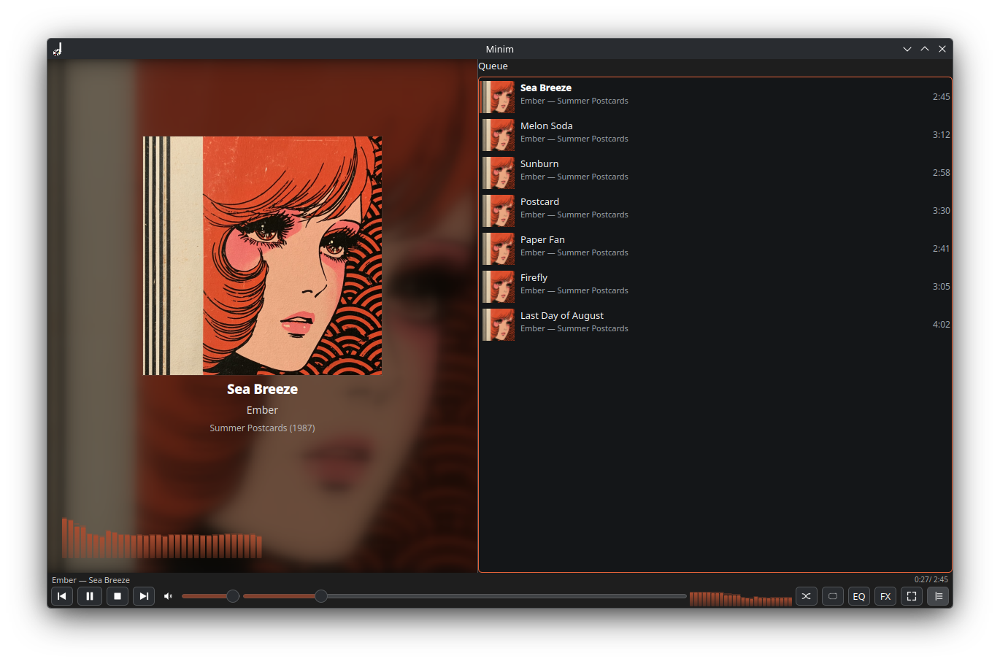

# Quaver and Minim

A media library manager and a simple media player for the Linux desktop, sharing one engine.



Quaver is a media library for the Linux desktop: music, TV series, movies,
podcasts and YouTube, all through one queue. Minim is its lightweight
sibling: open a file and it plays, with no library and no scanning. I built
Quaver to get MusicBee's album-first library on Linux, then grew it into one
queue for everything I listen to and watch; Minim covers the other case, a
file in Downloads that should just play. Both are built with PySide6 and
GStreamer on a shared engine, so playback, the queue, Now Playing and the
equalizer behave the same in each.

## Features

**Quaver, the library**

- Album-centric music library: artists, albums grouped by year, cover art from tags or folder images
- Series and movies matched against TVmaze, or TMDB with your own API key, with Kodi `.nfo` overrides
- Files tabs that browse any folder as a thumbnail grid
- Podcasts from the iTunes directory, with auto-download, retention and resume
- YouTube channels through yt-dlp: search, subscribe, stream or download
- Saved playlists, and an Auto-DJ that keeps the queue topped up from the library
- Tag editor for one or many tracks, with MusicBrainz and AcoustID lookup
- Sources on local disks or SMB shares, mounted through KIO FUSE

**Minim, the player**

- Plays whatever you open: from the file manager, the command line, Ctrl+O or drag and drop
- Drop on the artwork to play now, on the queue to add; a folder queues every file in it
- No library and no history: each launch starts with an empty queue

**Both, from the shared engine**

- Gapless playback, ReplayGain, a 10-band equalizer with presets, a compressor and 0.5–2× speed
- Video, with ASS/SSA subtitles rendered by libass, SRT and VTT, and audio and subtitle track switching
- Now Playing: large artwork on a blurred or gradient background, with a spectrum visualizer
- Fullscreen with a floating transport, MPRIS2 media controls, and KWin blur behind a translucent window

## Status

In progress, and working on Fedora 44 with KDE Plasma 6 on Wayland, run from a
checkout, and on SteamOS 3.9 as Flatpaks. In development: a built-in SMB
client, so network sources work in the Flatpaks too. Missing: a Flathub
listing (the Flatpaks build from this repository) and testing on other
distributions.

## Built with

Python 3 and PySide6 (Qt 6), with GStreamer 1.x through PyGObject for audio
and video. libass, called through ctypes, renders subtitles; mutagen, SQLite
and watchdog run the library; musicbrainzngs, pyacoustid, feedparser, httpx
and yt-dlp handle lookups, podcasts and YouTube; dbus-python provides MPRIS2.
It targets Linux: Fedora's system Python and RPMs, on KDE Plasma 6. The
Flatpaks get the same from KDE's Flatpak runtime, with PySide6 from Qt's base
app and their own builds of PyGObject, dbus-python, libass and Chromaprint.

| Directory | What it is |
|---|---|
| `quaver/` | The library app |
| `minim/` | The click-to-play player |
| `media_core/` | The shared engine: playback, transport, queue, Now Playing and MPRIS2 |
| `flatpak/` | The Flatpak manifests, their pinned Python packages, and their software-centre metadata |

## Build and run

The apps run on the system Python against Fedora packages, with no
virtualenv: the GStreamer bindings and PySide6 come from RPMs built for
`/usr/bin/python3`, which is why the launchers pin it.

```bash
sudo dnf install -y \
    python3-pyside6 qt6-qtwayland python3-gobject-base python3-dbus \
    python3-numpy python3-mutagen python3-platformdirs python3-tomli-w \
    python3-httpx python3-feedparser python3-watchdog python3-musicbrainzngs \
    python3-pip python3-pytest yt-dlp chromaprint-tools libass \
    gstreamer1-plugins-base gstreamer1-plugins-good \
    gstreamer1-plugins-bad-free gstreamer1-plugins-ugly-free \
    gstreamer1-plugin-libav gstreamer1-plugin-openh264 gstreamer1-plugin-dav1d
/usr/bin/python3 -m pip install --user pyacoustid    # not packaged for Fedora

git clone https://github.com/jacksonvw/quaver.git
cd quaver
bin/quaver                  # the library
bin/minim video.mkv         # play a file, or a folder of them
```

In Quaver, add a folder under ☰ → Library → Add Source…, and it scans it into
the library. Logs go to `/tmp/quaver.log` and `/tmp/minim.log`. Settings live
in `~/.config/quaver/` and `~/.config/minim/`, and Quaver's library database in
`~/.local/share/quaver/`. The TMDB scraper needs your own API key, entered in
Preferences.

`desktop/install.sh` links `bin/quaver` and `bin/minim` into `~/bin`,
installs both apps' desktop entries and icons, and makes Minim the default
player for the audio and video types it declares. It needs no root and is safe to
re-run, including after moving the checkout.

Every package above comes from Fedora's own repositories, which decode
H.264, AAC, AC-3 and AV1 but not HEVC or E-AC-3; RPM Fusion's full `ffmpeg`
adds those. Other distributions need the equivalent packages.

On any distribution with Flatpak, SteamOS included, both apps build as
Flatpaks instead, with nothing installed outside Flatpak; the runtime decodes
HEVC and E-AC-3 too. Quaver's Flatpak carries Minim as well, for Open in Minim:

```bash
flatpak install flathub org.flatpak.Builder \
    org.kde.Platform//6.11 org.kde.Sdk//6.11 io.qt.PySide.BaseApp//6.11

git clone https://github.com/jacksonvw/quaver.git
cd quaver
flatpak run org.flatpak.Builder --user --install --force-clean \
    build/flatpak flatpak/com.jacksonv.Quaver.yml
flatpak run org.flatpak.Builder --user --install --force-clean \
    build/flatpak flatpak/com.jacksonv.Minim.yml
desktop/install.sh --flatpak    # Minim as the default player
```

Minim's Flatpak can read any file but change none; Quaver's can write too, for
the tag editor and downloads. Their logs go to
`~/.var/app/com.jacksonv.Quaver/cache/quaver.log` and
`~/.var/app/com.jacksonv.Minim/cache/minim.log`, and their settings and
Quaver's library database to the `config/` and `data/` folders beside them.
SMB sources don't work in the Flatpaks yet, since a sandbox can't reach KIO
FUSE's mounts. A built-in SMB client, as Kodi has, is in development; until
then, a share mounted as an ordinary folder works. Moving from a
checkout install to the Flatpaks, delete
`~/.local/share/applications/quaver.desktop` and `minim.desktop`, or both
versions appear in the app menu. `flatpak/README.md` covers updating the
Python packages they bundle.

The tests run headless, on Qt's offscreen platform, in a couple of seconds:

```bash
/usr/bin/python3 -m pytest quaver/quaver/tests/ minim/minim/tests/
```

## More screenshots











The albums and the podcast in these screenshots are made up for the demo.
The video is the trailer for *Sintel*, © Blender Foundation,
[CC BY 3.0](https://creativecommons.org/licenses/by/3.0/).

---

Jackson Vander Wal · [jacksonv.com](https://jacksonv.com)
